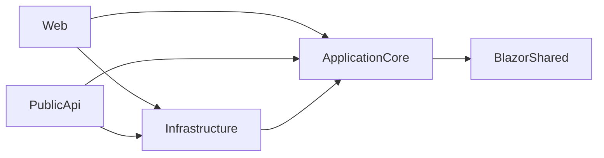

# Stack reference

Warm context. Read it when the task touches build, tests, packages, or project
structure. Behavioral rules live in [.github/copilot-instructions.md](../../.github/copilot-instructions.md).
Open questions go in [cold/gap-log.md](cold/gap-log.md).

Every fact below was taken from the repo files named beside it.

## Summary

| Item | Value | Source |
| --- | --- | --- |
| Language | C# (`LangVersion` latest in Web/UnitTests, nullable enabled) | `src/**/*.csproj` |
| Runtime / SDK | .NET 10 (`net10.0`), SDK 10.0.0 with `rollForward: latestFeature` | `Directory.Packages.props`, `global.json` |
| Framework | ASP.NET Core (Razor Pages/MVC in `Web`, FastEndpoints in `PublicApi`, Blazor WebAssembly in `BlazorAdmin`) | `src/*/*.csproj` |
| Data | EF Core 10, SQL Server, or in-memory when `UseOnlyInMemoryDatabase=true` | `src/Infrastructure/Dependencies.cs` |
| Build tool | `dotnet` CLI on `eShopOnWeb.slnx`. Packages managed centrally. | `Directory.Packages.props` |
| Test runner | xUnit v3 (`xunit.v3`) via `dotnet test`. One exception, see below. | `tests/**/*.csproj` |
| Architecture constraint | Clean Architecture. `ApplicationCore` depends on no infrastructure project. | project references |

## Language and framework

- Target framework is set once in `Directory.Packages.props` (`net10.0`). Do not set
  `TargetFramework` in individual projects.
- Style is enforced by `.editorconfig`: file-scoped namespaces (warning), 4-space indent
  in `.cs`, private fields `_camelCase`, braces always, UTF-8 BOM, final newline.
- Root namespace prefix is `Microsoft.eShopWeb`.
- Domain library choices (already in use, stay with them):
  - `Ardalis.Specification` for queries, `Ardalis.GuardClauses`, `Ardalis.Result`
  - `Mediator` (source-generated, `Mediator.Abstractions` + `Mediator.SourceGenerator`).
    This is not MediatR.
  - `FastEndpoints` for `PublicApi` endpoints
  - `AutoMapper` for mapping
  - `NimblePros.SharedKernel` and `NimblePros.Metronome`
- Observability and hosting: .NET Aspire. `src/eShopWeb.AppHost` orchestrates,
  `src/eShopWeb.AspireServiceDefaults` holds shared OpenTelemetry/resilience setup.
  Deployment uses `azure.yaml` and `infra/*.bicep`.

## Solution layout

| Project | Role |
| --- | --- |
| `src/ApplicationCore` | Entities, aggregates, interfaces, services, specifications |
| `src/Infrastructure` | EF Core contexts, `EfRepository<T>`, Identity, migrations |
| `src/Web` | Razor Pages/MVC site, hosts `BlazorAdmin` |
| `src/PublicApi` | FastEndpoints REST API, JWT auth |
| `src/BlazorAdmin` | Blazor WebAssembly admin UI |
| `src/BlazorShared` | Models shared by the Blazor client and core |
| `src/eShopWeb.AppHost`, `src/eShopWeb.AspireServiceDefaults` | Aspire orchestration and defaults |
| `tests/*` | See Tests |

## Build tool

Run from the repo root.

```powershell
dotnet restore eShopOnWeb.slnx
dotnet build eShopOnWeb.slnx --no-restore
dotnet format eShopOnWeb.slnx --verify-no-changes
```

- Run the full local pipeline (restore, build, every test project, format check) with
  `dotnet ./BuildTestFormat.cs`.
- CI (`.github/workflows/dotnetcore.yml`) builds with `--configuration Release`, then runs
  `dotnet test eShopOnWeb.slnx --collect:"XPlat Code Coverage"`.
- Add or bump a NuGet package by editing only `Directory.Packages.props`
  (`ManagePackageVersionsCentrally=true`). `.csproj` files reference packages without a
  version.
- Run the web app: `dotnet run --project src/Web/Web.csproj` (HTTPS on `https://localhost:5001`).
  VS Code tasks `build`, `publish`, and `watch` target `src/Web/Web.csproj`.

## Test runner

Default: **xUnit v3**, `[Fact]` and `[Theory]`, mocks with **NSubstitute**,
coverage with `coverlet.collector`. Run with `dotnet test <project>`.

| Project | Framework | Scope |
| --- | --- | --- |
| `tests/UnitTests` | xUnit v3 | `ApplicationCore`, Mediator handlers, Web helpers. No I/O. |
| `tests/IntegrationTests` | xUnit v3 | EF repositories against the in-memory provider |
| `tests/FunctionalTests` | xUnit v3 | `WebApplicationFactory` against `Web` and `PublicApi` |
| `tests/PublicApiIntegrationTests` | **MSTest** (`[TestMethod]`) | `PublicApi` endpoints. Exception to the default. |
| `tests/EndToEndTests` | xUnit v3 + Playwright | Browser tests against `https://localhost:5001` |

Commands:

```powershell
dotnet test tests/UnitTests/UnitTests.csproj
dotnet test tests/UnitTests/UnitTests.csproj --filter "FullyQualifiedName~BasketAddItem"
dotnet test eShopOnWeb.slnx
```

- Match the framework of the project you edit. Do not add MSTest to an xUnit project or
  the reverse.
- Tests are grouped by feature folder, one scenario class per file (for example
  `UnitTests/ApplicationCore/Entities/BasketTests/BasketAddItem.cs`). Place new tests in
  the folder that mirrors the production namespace.
- End-to-end tests need Playwright browsers once per machine:
  `dotnet build tests/EndToEndTests/EndToEndTests.csproj`, then
  `pwsh tests/EndToEndTests/bin/Debug/net10.0/playwright.ps1 install`.
  The fixture launches `Web` itself. Details in `tests/EndToEndTests/README.md`.
- `tests/EndToEndTests` is part of `eShopOnWeb.slnx`, so a solution-wide `dotnet test`
  runs it. Use a per-project command when you do not need browsers.

## Architectural constraint

**Dependencies point inward. `ApplicationCore` must not reference `Infrastructure`, `Web`,
`PublicApi`, or any EF Core/ASP.NET Core UI package.**



- `ApplicationCore` references only `BlazorShared` plus abstraction packages
  (`Ardalis.*`, `Mediator.Abstractions`). Verify in `src/ApplicationCore/ApplicationCore.csproj`.
- Data access is expressed as `IRepository<T>` / `IReadRepository<T>` (constrained to
  `IAggregateRoot`) defined in `ApplicationCore/Interfaces`. `Infrastructure/Data/EfRepository<T>`
  implements them. Services in `ApplicationCore` depend on the interfaces only.
- Put business rules in `ApplicationCore` entities and services. Do not put them in controllers,
  Razor Pages, endpoints, or EF configuration.
- Queries use `Ardalis.Specification` classes in `ApplicationCore/Specifications`,
  not ad hoc `IQueryable` in callers.
- Check the project reference direction before adding any `ProjectReference` or `using`
  that crosses a layer.

## Known gaps

- `src/ApplicationCore` references `BlazorShared`. That is how the repo is today. Do not
  extend that dependency without asking.
- Record anything unverified in [cold/gap-log.md](cold/gap-log.md).
